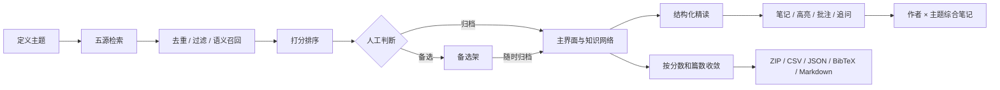

# AutoPaper

链接：https://github.com/GoldenR1ver/AutoPaper

AutoPaper 是一个本地科研工作台，把「收集论文 → 阅读论文 → 归档论文」串成一条可以重复运行的流水线。

它从 arXiv、Crossref、OpenAlex、PubMed 和 Semantic Scholar 收集题录，去重、过滤、打分，把值得留下的论文放进主界面；再按需调用模型做结构化精读，把高亮、批注和追问沉淀成笔记；最后按主题收敛、打包成可交付的题录和原件。所有数据都在本机。没有模型密钥时，检索、去重、筛选、排序、导出和题录整理仍然可用。

## 完整工作流



### 1. 收集：从一个研究问题得到一份候选名单

一个主题会保存检索式、主题词、排除词、领域标签、数据源、起始年份和筛选方案，所以同一次检索可以反复运行、逐年更新。

- 五个数据源的结果先归一成同一种 `Paper`，再按 DOI、标题和其他标识去重。
- 排除词、主题词（任一或全部）、领域标签（宽松或严格）逐层过滤；配置了向量接口时，字面没命中的相近论文会按相似度补回候选。
- 排序分数由关键词覆盖、标题命中、被引和年份组成；配置模型后，只对前 `llm_top_n` 篇重新打分，并给出一句入选理由。
- 收集过程中就可以逐篇判断：分数高于 95 的默认归档，其余进入备选架；也可以反过来手动指定。归档时会尝试把开放获取的 PDF 下载到论文库。

### 2. 阅读：把一篇论文拆成可核对的结构

打开一篇论文，左侧是结构化笔记，右侧是原文分栏。笔记固定回答：领域与领域现状、知识网络坐标、背景、问题、方法、实验、结果、能否解决问题、新问题、方法/方向/理论上的创新与不足、复现思路，并额外整理一句话、主张与证据、关键术语和需要核对的地方。

- 只有摘要时也能读，实验和复现会明确写“依据不足”；超长论文保留开头和结尾。
- 每一段都能双击单独改；`更新笔记` 会重新调用模型，已有高亮和批注不会丢失。
- 划取文字可以加五色高亮或写批注，也可以点「追问」让模型解释这段与全文、作者、主题、方法和证据的关系。满意的回答可以一键保存进同一条笔记和「我的笔记库」。
- 同一作者、同一主题下的论文会再综合成一份笔记，说明共同问题、各篇角色、方法/方向/理论线索和仍未回答的问题。

### 3. 归档：让名单收敛成可交付的材料

归档不是删除，而是分层：主界面只放你认可要读的论文，备选架保留暂时不用的结果，随时可以归档回来。

- 可以按分数和篇数把论文改为备选或从库里删除；已有本地原文的论文默认不参与删除。
- 一个主题可以打包成 ZIP：题录（CSV、JSON、BibTeX、Markdown 候选名单）、`files/` 里的原件，以及一份逐篇说明。打包前会再试一次下载缺失的开放原文。
- 报告停在可核对的材料上：年份、出处、作者分布、代表论文和引用列表；有模型时再补“领域现状、主要路线、不足与开放问题”，并且只允许依据给定摘要。

## 设计理念

1. **本地优先，数据可以搬走。** 题录在 SQLite，原文、笔记和导出在普通目录。换一台机器，复制 `data/` 就能继续工作。
2. **一个主题是一份可重复的设置。** 检索式、主题词、排除词、标签、来源和年份都跟着主题保存，不依赖某次手工搜索的记忆。
3. **题录、原文、笔记分层保存。** 论文记录合并去重，原文按论文名归类，笔记跟着论文目录走，综合笔记按作者和主题单独存放。任何一层都可以单独重建或删除。
4. **机器做苦力，人做最后一道筛子。** 检索、去重、过滤、打分、归纳交给程序；留下哪些、怎么读、删不删由人决定。自动规则只是默认值，不是结论。
5. **只依据手头文本。** 所有生成都限制在给定的论文、摘要和笔记里；没有写的内容明确标成“论文文本未说明”，不编造论文、数字或结论。
6. **渐进增强。** 没有密钥也能完成检索、筛选、排序、导出、题录和图谱；配置模型后才增加摘要打分、精读、笔记和综述；再配置向量接口才有语义召回和向量相关度。

## 主要操作方式（前端）

启动本机界面：

```powershell
python -m autopaper serve
```

浏览器会打开 `http://127.0.0.1:8765/`。顶栏是入口，左侧是筛选和论文列表，中间是图谱或论文表，右侧是阅读器。

| 想做的事 | 入口 | 结果 |
| --- | --- | --- |
| 建立主题并检索 | 「收集论文」或「主题收集」 | 主题、候选、分数与入选理由 |
| 边收边判断 | 收集时右侧的「收集判断」 | 归档的进主界面，备选的进备选架 |
| 看全局、找关系 | 「知识网络」+「图谱 / 论文表」 | 论文、作者、主题、引用组成的网络 |
| 精读一篇 | 点论文节点或表格标题 | 结构化笔记 + 原文分栏 |
| 记下想法 | 在笔记里划词 | 五色高亮、批注、追问，保存进我的笔记库 |
| 整理笔记 | 阅读器顶部「编辑笔记 / 更新笔记 / 补充附件」 | 可改的 Markdown 笔记和附件 |
| 收敛一个主题 | 「主题收集」里的分数、篇数和三个处理按钮 | 更小的归档集合或更干净的备选区 |
| 交付 | 「打包 ZIP」或论文表右上角导出 | 题录 + 原件 + 说明 |
| 收录自己的论文 | 「上传论文」 | 按作者和主题归类，自动识别题录并生成笔记 |
| 修题录、去重 | 「补全题录」「合并重复」 | 年份/出处/DOI/链接，合并同一篇论文 |

第一次使用可以按这个顺序走：

1. 在「收集论文」里新建主题，选一个筛选方案，填主题词和起始年份，点「开始收集」。
2. 在「收集判断」里把该留的论文点成「归档」，其余留在备选。
3. 回到图谱，点开一篇归档论文，读笔记、看原文、划词追问。
4. 在「主题收集」里按分数和篇数收敛，打包 ZIP 或导出 BibTeX。

左侧图谱的几个常用控制：四个图层开关控制「笔记相近 / 同一作者 / 同一主题 / 引用」；「相关度」滑块只影响笔记相近的连线；「节点上限」控制同时显示多少篇；作者、主题、年份、出处、阅读状态都可以多选筛选；按 `/` 直接跳到搜索框。

## 安装

在项目目录打开 PowerShell：

```powershell
python -m venv .venv
.\.venv\Scripts\Activate.ps1
pip install -e ".[dev]"
copy config.example.yaml autopaper.yaml
copy .env.example .env
python -m autopaper init
python -m autopaper doctor
```

把 `autopaper.yaml` 里的 `mailto` 改成真实邮箱，OpenAlex 和 Crossref 会把请求放进礼貌池。模型密钥写在 `.env`：

```text
OPENAI_API_KEY=sk-...
OPENAI_BASE_URL=https://api.deepseek.com
AUTOPAPER_MODEL=deepseek-flash
```

只填 `DEEPSEEK_API_KEY` 时，会自动使用 `https://api.deepseek.com` 和 `deepseek-flash`；但 `.env` 里如果还留着空的 `OPENAI_API_KEY=`，请把它删掉，否则程序会认为你选择了 OpenAI。DeepSeek 没有 embedding 接口，语义召回会跳过；需要用别的服务做向量时，再填 `AUTOPAPER_EMBEDDING_*`。

## 数据在哪

```text
data/
  autopaper.sqlite        # 题录、主题、作者、笔记、高亮、运行记录
  library/<论文名>/       # 原文、title.txt、note.md、note.json
  notes/                  # 作者笔记、主题笔记、作者×主题综合笔记、我的笔记库
  exports/<主题 id>/      # latest/ 与带日期的题录，以及打包的 ZIP
  reports/                # 主题报告、精读报告、研究者画像
  logs/autopaper.log
```

复制 `data/` 就是完整备份。论文库里的原件和 `note.md` 也可以脱离程序直接阅读。

## 使用边界

- 五个数据源不需要付费密钥，但会限速；arXiv 默认每次请求间隔 3 秒。
- Crossref 经常没有摘要，这些论文主要靠标题参与过滤和排序。
- 精读时 PDF 文本会截到约 12 万字符，超长论文保留开头和结尾；具体能送多少还受模型上下文限制。加密 PDF 无法提取。
- 精读和综述只根据手头文本生成，不是实验复现器，也不能代替你核对原文中的数字。
- 界面默认只监听 `127.0.0.1`，没有登录验证，不要直接暴露到公网或不可信的局域网。

## 更多

- 前端逐步操作、命令行、HTTP 接口、数据布局和常见问题：[docs/USAGE.md](docs/USAGE.md)
- 阅读、打分、综述和追问的提示词：`src/autopaper/llm/prompts.py`
- 开发检查：`pytest`
