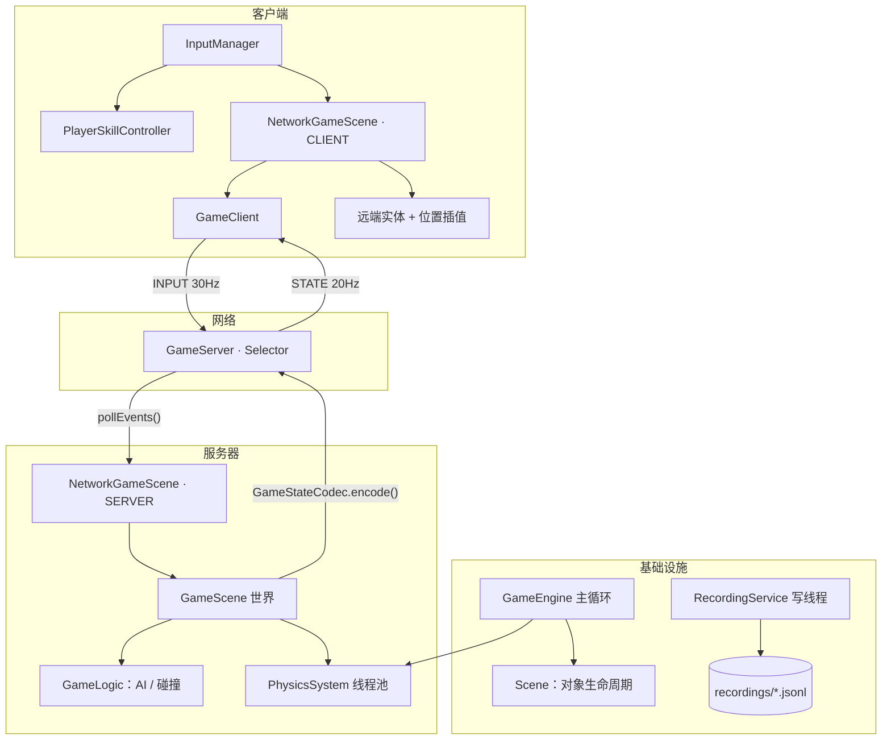

<div align="center">

# 葫芦娃大战妖精 · Hulu Battle

**一个用 Java 从零实现的 2D 联机对战游戏**

ECS 组件架构 · OpenGL 渲染 · NIO 服务器权威同步 · 关键帧录像与回放


<br>


<sub>左：客户端视角的联机对战（青色为服务器上的其他玩家，蓝色为 AI）　右：主菜单</sub>

</div>

---

## 简介

玩家扮演葫芦娃，在场地中与不断涌来的妖精战斗：用近战扇形火焰、蓄力水枪和闪避走位生存下来，
沿途捡拾四娃／五娃／六娃／七娃的葫芦籽来强化技能。

项目没有使用游戏引擎，窗口、渲染、物理、输入、网络、录像全部手写，
因此代码里可以直接看到游戏引擎的各个子系统是如何协作的。

## 功能

| 模块 | 说明 |
| --- | --- |
| **ECS 架构** | `GameObject` 只做组件容器，`Component` 承载数据与行为，`Scene` 管理对象生命周期 |
| **GPU 渲染** | LWJGL + OpenGL 固定管线，AWT 生成字形纹理并上传 GPU，中英文均可显示 |
| **技能系统** | 三种技能：近战（按住持续攻击）、远程（蓄力）、闪避（短时加速 + 无敌），带魔力与冷却 |
| **武器掉落** | 敌人死亡概率掉落葫芦籽，四种类型 × 四种词条（伤害／冷却／射速／射程）叠加到技能属性 |
| **粒子特效** | 对象池式的粒子系统，支持持续喷射与一次性爆发 |
| **联机对战** | 服务器权威：服务器跑全部游戏逻辑，客户端只发输入、渲染快照并做预测与平滑 |
| **录像回放** | JSONL 关键帧录像，独立写线程异步落盘，回放时按时间戳线性插值 |

## 快速开始

**环境要求**：JDK 11+、Maven 3.8+

### Windows

```bat
run.bat
```

会进入一个菜单，按数字选择即可：

```
1  Single player          单机
2  Host a server          作为主机开服
3  Join a server          作为客户端加入
4  Host + join            一键开两个窗口做本地联调
5  Replay latest match    回放最近一局
6  Run tests              运行测试
```

也可以跳过菜单直接启动：

```bat
run.bat server             :: 默认端口 7776
run.bat client 127.0.0.1
run.bat replay
```

### Linux / macOS

```bash
chmod +x run.sh
./run.sh
```

> macOS 需要额外把 `pom.xml` 里的 `natives-windows` / `natives-linux` 换成 `natives-macos` 或 `natives-macos-arm64`。

### 手动运行

```bash
mvn compile
mvn dependency:build-classpath -Dmdep.outputFile=target/classpath.txt

# Windows（CMD 用 ; 分隔，Linux/macOS 用 :）
java -cp "target/classes;$(cat target/classpath.txt)" com.gameengine.example.Game
```

## 操作

| 按键 | 功能 |
| --- | --- |
| `W` `A` `S` `D` / 方向键 | 移动 |
| 鼠标 | 瞄准（技能方向） |
| `Z`（按住） | 近战喷火，扇形范围持续伤害 |
| `X`（按住蓄力，松开发射） | 远程水枪 |
| `C` | 闪避：短暂加速 + 无敌 |
| `ESC` | 返回主菜单 |

## 架构



**三条线程边界**，是这次设计的核心：

1. **游戏线程**（主线程）：主循环、物理、玩法、快照编码。所有 `Scene` 读写只在这里发生。
2. **网络线程**：`Selector` 只负责收发字节与维护会话，通过无锁队列与游戏线程交换 `JOIN / INPUT / LEFT` 事件与状态字符串。
3. **录像线程**：从有界队列取行写文件，队列满时丢弃而不是阻塞主循环。

这样避免了"网络线程遍历场景导致的 `ConcurrentModificationException`"和"在 Selector 线程里阻塞写导致全服卡死"这两类典型问题。

## 网络协议

UTF-8 文本行协议，`\n` 分隔，客户端与服务器共用 `Protocol` 中的编解码。

| 方向 | 消息 | 说明 |
| --- | --- | --- |
| C → S | `JOIN:玩家名` | 加入游戏，服务器回 `JOIN_ACK` |
| C → S | `INPUT:seq,vx,vy,melee,ranged,dodge,aimX,aimY` | 30Hz 上行，含序号用于预测 |
| C → S | `PING` | 心跳，5s 一次 |
| S → C | `WELCOME:sessionId` | 分配会话号 |
| S → C | `STATE:{json}` | 20Hz 全量快照 |
| S → C | `PLAYER_LEFT:sessionId` / `ERROR:原因` | 通知 |

服务器侧做了输入限流（120 条/秒/连接）、单行最大长度限制、最大连接数与 30s 心跳超时，
客户端侧做了按字节切行（正确处理 TCP 半包 / 粘包）与唯一写线程。

状态快照只同步白名单实体（玩家、AI、子弹、掉落物），并用 `GameObject` 的全局自增 `id` 关联，
不依赖对象地址，客户端据此创建、更新、销毁远端实体。

## 录像与回放

`recordings/` 下每局一个 `.jsonl` 文件，每行一个 JSON 对象：

| 行类型 | 内容 |
| --- | --- |
| `header` | 版本、窗口尺寸 |
| `input` | 瞬时按键集合 |
| `mouse` | 鼠标位置（10Hz 采样） |
| `keyframe` | 所有实体的位置、渲染参数、血量、魔力、技能状态（0.5s 一帧） |

回放按时间戳在两个关键帧之间线性插值，实体通过唯一 id 追踪，因此敌人死亡后不会"瞬移"。

## 项目结构

```
src/main/java/com/gameengine
├── core/        引擎核心：主循环、GameObject/Component、物理、粒子、玩法逻辑
├── components/  可挂载组件：变换、物理、渲染、血量、技能、武器、掉落
├── scene/       场景基类：对象容器与生命周期
├── graphics/    OpenGL 渲染器与渲染器工厂
├── input/       输入管理、玩家技能控制器
├── net/         协议、NIO 服务器/客户端、状态编解码
├── recording/   录像服务、JSON 工具、存储抽象
├── config/      集中式参数配置
└── example/     游戏内容：场景、菜单、启动器

src/test/java         协议 / 编解码 / JSON / 向量 / 网络回环测试
docs/                 README 截图
```

## 测试

```bash
mvn test
```

共 17 个测试，其中 `NetworkRoundTripTest` 会真实启动一个 `Selector` 服务器与客户端，
验证 `JOIN → INPUT → STATE → 断线通知` 全链路；`GameStateCodecTest` 保证快照编解码无损。

## 参数调优

常用参数集中在 `com.gameengine.config.GameConfig`，例如：

| 参数 | 默认值 | 含义 |
| --- | --- | --- |
| `WINDOW_WIDTH` / `WINDOW_HEIGHT` | 1920 × 1080 | 窗口与逻辑坐标 |
| `INITIAL_AI_PLAYERS` | 30 | 初始 AI 数量 |
| `MAX_AI_PLAYERS` | 40 | AI 上限 |
| `AI_SPAWN_INTERVAL` | 1.0s | 补怪间隔 |
| `DEFAULT_NETWORK_PORT` | 7776 | 默认端口 |
| `NETWORK_STATE_INTERVAL` | 1/20s | 服务器广播频率 |

## 已知限制

- 目前是**合作模式**：玩家技能只对 AI 生效，尚无 PvP 伤害判定。
- 状态同步为 20Hz **全量快照**，未做增量压缩；人数较多时上行带宽会明显增长。
- 服务器为明文 TCP、无身份验证，仅适用于局域网或本机联调。
- 难度曲线偏硬：30 个 AI 同时围攻，生存时间通常在十秒量级。
