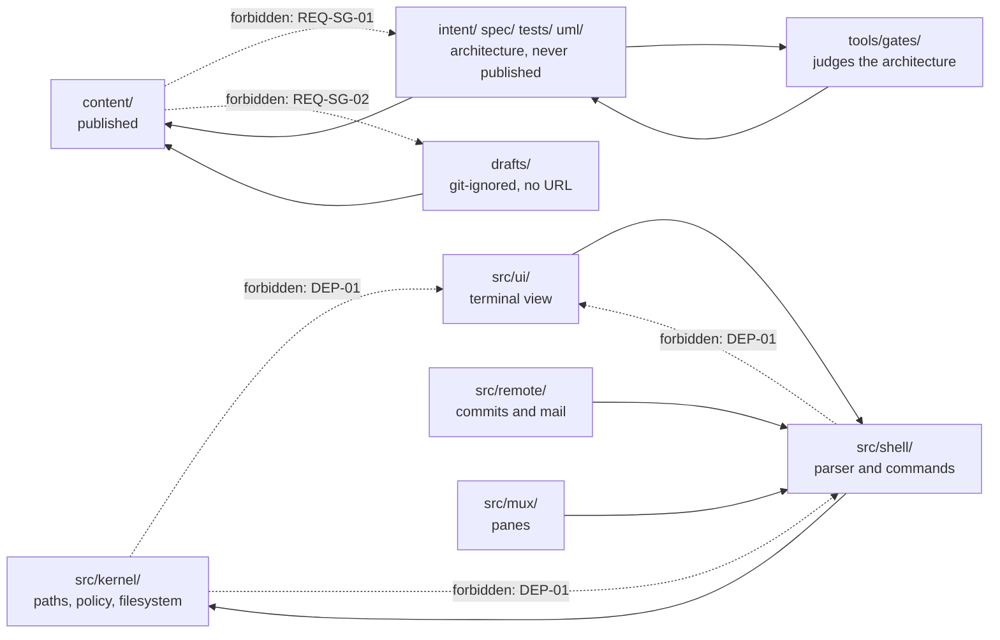

# Dependency diagram

Zones and the rules between them. Checked against `REQ-SG-01`, `REQ-SG-02`,
`REQ-SG-10` and `DEP-01`.

What each edge means

| Edge | Kind | Why |
| --- | --- | --- |
| drafts to content | allowed, manual | a draft becomes a page only when a person copies it into `content/` and commits |
| architecture to content | allowed, one way | `content/` is written by hand; no file is copied out of the architecture |
| architecture to gates | allowed | the gates read `spec/` and `tests/` |
| gates to architecture | allowed | a gate returns an exit code; it never writes an artifact |
| shell to kernel | allowed | commands reach the filesystem through the kernel |
| ui, mux, remote to shell | allowed | the view, the panes and the network dispatch into the command table |
| shell or kernel to ui | forbidden | `DEP-01` keeps the bottom layer free of the view |
| content to architecture | forbidden | `REQ-SG-01`; the build walks `content/` and nothing else |
| content to drafts | forbidden | `REQ-SG-02`; drafts are git-ignored and have no published path |

Why the direction matters

`content/` is the only published zone, so it must stay readable as plain files
with no import from anywhere. `drafts/` is the only zone that is both uncommitted
and unpublished, so it must stay outside `content/`: its whole value is having no
URL. The kernel is the bottom of the runtime, so it must stay free of the view.
Each rule is cheap to check and each has a gate that goes red on a sample.
