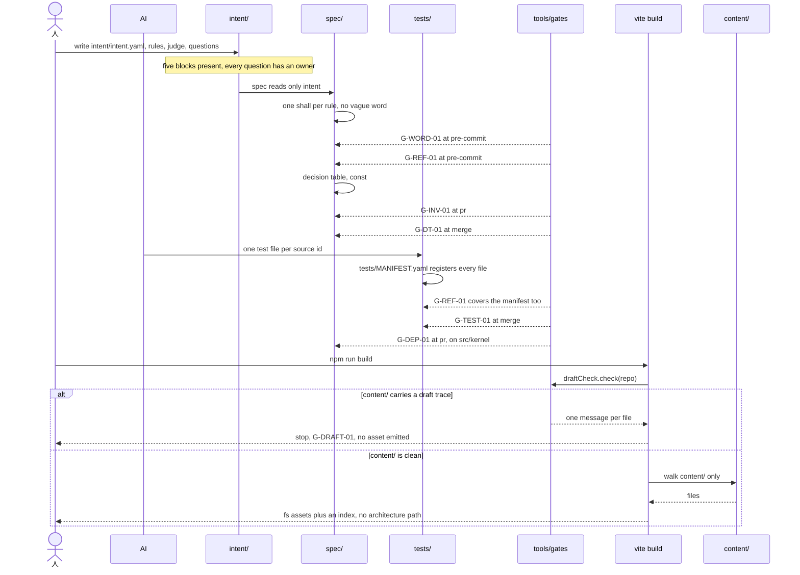

# Sequence diagram

One round, and where each gate fires. Checked against `REQ-SG-01`, `REQ-SG-16`
and `POST-01`.

Two branches that are deliberately absent

- No branch hands a draft to the site. `vite/content.ts` refuses to start emitting
  when `draftCheck` reports a trace, so the leak never becomes a URL.
- No branch writes during a check. Every gate reads files and returns an exit
  code; `npm test` renders the verdict, not the gate.
