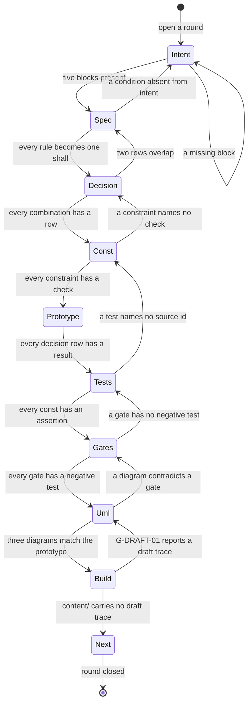

# State diagram

One round, from an empty `intent/` to the next round. Checked against
`REQ-SG-04` and `REQ-SG-08`.

What each rollback edge means

| Edge | Trigger | Gate that catches it |
| --- | --- | --- |
| Spec to Intent | a condition that intent does not state | review, `J4` |
| Decision to Spec | a combination with no row, or two rows that overlap | `G-DT-01` |
| Const to Decision | a constraint naming a check that cannot be written | `G-INV-01` |
| Tests to Const | a test file with no source id | `G-REF-01` |
| Uml to Gates | a picture that claims a gate the file does not carry | review |
| Build to Uml | a draft trace in `content/` | `G-DRAFT-01` |

Two states that cannot be reached

- No state publishes an artifact. `FORB-01` forbids a manifest path under the
  workspace, and the build only walks `content/`.
- No state enters the site. `REQ-SG-02` and `FORB-04` forbid the command name in
  the table, in `help`, in `man` and in completion.
